# News reader pipeline: recon and proposal

Written 2026-10-17. Recon only; nothing built. Goal: get full articles from world media as Markdown, on our own machine, without logging into sites, and read them as cheaply as possible (Clef now, BitMob later).

## What we have today

- `probes/world-engine/build_news_bank.py` pulls **headlines only** from ~70 public RSS feeds (BBC, NPR, Guardian, Al Jazeera, DW, France 24, NHK, Japan Times, Times of India, The Hindu, Straits Times, ABC Australia, CBC, Premium Times, Daily Maverick, Arab News, tech and science feeds, satire). 1,243 headlines in the last pull. No article text.

## Recon (checked against each project's own docs)

| Need | Candidate | What its docs say | Fit |
|---|---|---|---|
| World breadth (which stories exist) | **GDELT DOC 2.0 API** | Article URLs, titles, source country, language, date; monitors media in 65 languages (machine-translated); free for "academic, commercial, or governmental use of any kind" with a citation and link | Discovery across countries our 70 feeds miss. URLs only, no text |
| Full text → Markdown | **Trafilatura** | Python package/CLI; extracts main text and metadata, drops boilerplate; outputs TXT and **Markdown**; Apache 2.0; claims it beats other open-source extractors in benchmarks (not verified by us) | **Default extractor.** No browser needed, so fast and light |
| Pages that need JavaScript | **Crawl4AI** | Open-source crawler for LLMs; "clean, LLM-ready Markdown"; Docker self-hosting; drives a real browser | Fallback only for pages Trafilatura gets nothing from (heavier: a browser per page) |
| A reader UI and feed store | **Miniflux** (Docker) | Per-feed **scraper rules** (CSS selectors on the original page) and a REST API; no automatic full-text extraction mentioned | Optional. Not needed for the pipeline; Trafilatura does extraction without per-site rules |
| Named entities (people, places, organisations) | spaCy small models locally; compromise / wink-nlp in Cloudflare Workers | Not checked this session | Tier 0: routing (country, topic hints), de-duplication, filters |
| Reading with images | **Clef Flash** (local GPU, text and images; Image Lab uses it) | Measured here: 4.2 s per headline for 328 questions | Default reader |
| | **Jev 1.14** (hosted) | Per secondary sources: images behind an opt-in header (`TypeSafe-Danger-Zone-Images: true`), PNG/JPEG, "less reliable than text"; $0.042 per million input tokens, output free. **Tokens per image not published** | Cost per image unknown; one test call would measure it (hosted: needs your OK) |
| Balance ("not slanted") | A published media-bias rating (e.g. AllSides) | Could not read the AllSides chart (blocked) | Use a rating to balance the source list and report the mix; source to be chosen |

## Proposed pipeline (on-prem)

```mermaid
flowchart LR
  A[70 RSS feeds + GDELT DOC API] -->|URL, title, source, date| B[De-duplicate<br/>hash title, source, date]
  B --> C[Fetch page<br/>polite: robots.txt, rate limit, no logins]
  C --> D[Trafilatura → Markdown + metadata]
  D -->|empty or too short| E[Crawl4AI in Docker<br/>browser fallback]
  E --> F
  D --> F[Markdown store, local, git-ignored, kept N days]
  F --> G[Tier 0: NER<br/>country, people, organisations, topic hints]
  G --> H[Clef reads: 328 questions<br/>headline + lead or full text]
  H --> I[World engine event]
  H -->|labels| J[(Training set for BitMob)]
  J -.->|later| K[BitMob reader<br/>~2 ms per story]
  K -.-> I
```

- **No logins, no paywall workarounds.** Paywalled pages count as "headline only".
- **Article text stays local and temporary** (git-ignored, deleted after N days). Only derived results are kept long-term, as in the service design.
- **How much text to read is a cost choice.** Clef's time grows with input length; the headline plus the first few paragraphs may give most of the signal. Measured in T2 below.

## Tests before building (method and pass bar first)

| # | Test | Method | Pass |
|---|---|---|---|
| T1 | Extraction yield | 200 article URLs from our 70 feeds (spread across sources); Trafilatura to Markdown | ≥85% give main text of ≥500 characters; median extraction ≤200 ms a page (download excluded); yield reported per source |
| T2 | How much to read | 100 stories; Clef answers the 328 questions on (a) headline, (b) headline + first 3 paragraphs, (c) full Markdown; time each | Pick the cheapest input whose moved conditions match (c) on ≥90% of stories |
| T3 | Breadth | One day of GDELT DOC API results vs our 70 feeds | Count countries and languages each covers; decide whether GDELT is worth adding |
| T4 | Jev image cost | One image call with the opt-in header | Tokens counted and cost per image reported. **Hosted: only with your OK** |
| T5 | Balance | Rate our source list with a published bias rating | Report the mix; fix gaps |

Local only throughout; nothing sent to a hosted model without asking.

## Sources

[Trafilatura docs](https://trafilatura.readthedocs.io/en/latest/) · [Crawl4AI docs](https://docs.crawl4ai.com/) · [Miniflux scraper rules](https://miniflux.app/docs/rules.html) · [GDELT DOC 2.0 API](https://blog.gdeltproject.org/gdelt-doc-2-0-api-debuts/) · [GDELT terms (About)](https://www.gdeltproject.org/about.html) · Jev 1.14 images and pricing (secondary sources, not TypeSafe's own page): [AlphaSignal](https://alphasignal.ai/news/typesafe-ai-s-jev-1-14-brings-vision-and-256k-context-to-typed-decisions), [aipricing.guru](https://www.aipricing.guru/typesafe-pricing/)

## Results (2026-10-17)

| Test | Result |
|---|---|
| Tool health (GitHub, PyPI, Context7) | feedparser 6.0.14 (Jul 2026), Trafilatura 2.3.1 (Oct 2026), RSSHub (daily releases), Miniflux 2.3.3, Crawl4AI active; Mozilla Readability last npm release Mar 2025; RSS-Bridge last release Aug 2025; Postlight/Mercury Parser dead (2022) |
| Social feeds without login | YouTube, Reddit, Mastodon, Bluesky native RSS all answered; X, Instagram stories, Telegram need accounts (RSSHub docs) |
| What RSS carries (63 of our feeds) | 5 full text, 14 partial (60–299 words), 44 title + teaser (<60 words; BBC ~18, NPR ~32); images on 49 |
| Is a teaser enough? (40 stories, Clef) | **No.** Share of the full text's conditions found: title 32%, 30 words 29%, 100 words 24%, 300 words 51%. Full text costs 5.7 s vs 3.4 s a read |
| Extraction (98 links, 14 mainstream feeds) | 6 sites refuse via robots.txt (honoured). Of 56 fetched: Trafilatura ≥300 words on 88% (median 714 words, 14 ms), Readability 88% (60 ms) |
| Extraction quality (49 full pages) | Two extractors agree (median 98% / 93% word overlap; 42 of 49 agree both ways at ≥85%); no boilerplate in 47 of 49; headline words found (median 100%). No publisher ground truth on these sites |
| Local (Boston, Quincy) | RSS + news sitemap: WBUR, Boston.com, Boston Herald, NBC Boston; Boston Globe (feed carries full text); WCVB sitemap only; Patriot Ledger (Quincy) paywalled (402), no feed |
| End to end (`newsreader` service + World engine) | First poll: 1,716 stories from 66 feeds in 3.3 s. Engine reads full text through Clef at 5.5–9.6 s a story. Open: sports stories move unrelated conditions (needs a relevance filter); newest-first lets one outlet dominate (needs round-robin); fetching ~1 story/s (to optimise) |

The news reader was GDELT-free by choice: its feed is broad but noisy.
