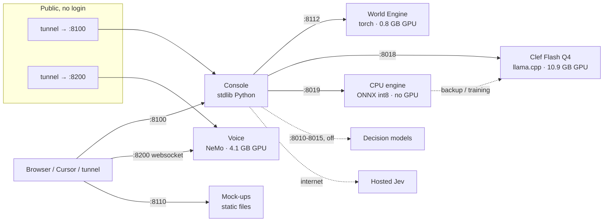
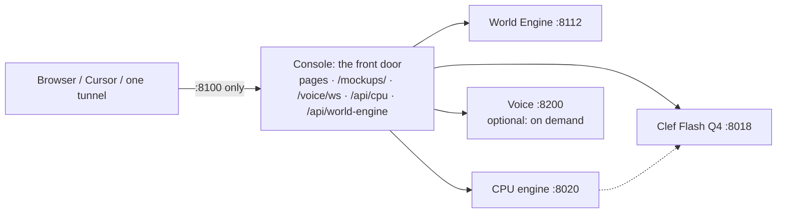
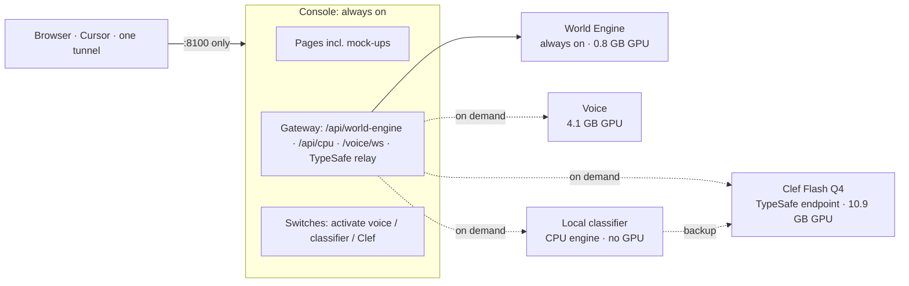

# Services: what runs, what talks to what, and what to consolidate

> **Status 16 Oct 2026: steps 1–4 below are done** (baseline profile with `up` / `reset` / `down`, classifier service on
> :8020, mock-ups and voice served through the console on :8100, top-bar switches for local visitors, World Engine v1
> retired to `probes/world-engine/_retired/`). Not done: voice on demand with an idle timeout; collapsing the World
> Engine menu entries; the dev flow pages.

Recon of 16 Oct 2026. Every figure was read from this machine (process list, `nvidia-smi`, `service.yaml`, the code), not
estimated, except where marked.

## The point

Keep separate processes where the software stacks or the GPU memory differ; there is no memory to save by merging them.
Fix the two things that actually hurt: **too many ports reaching the browser**, and **no single command for the ideal state**.
One front door (the console on :8100) can carry the voice websocket, the mock-ups and the CPU engine, so a laptop, Cursor
or a tunnel only ever needs :8100. One baseline profile plus `up` / `reset` / `down` gives the start-stop story.

## What is active now

| Service | Port | Process / stack | GPU | RAM | Up for | Called by |
|---|---|---|---|---|---|---|
| Console (`demo`) | 8100 | `demo/server.py`, system Python, standard library only | 0 | 225 MB | 1 h | the browser |
| World Engine (`world`) | 8112 | `world_service2.py`, kev venv (torch) | 0.8 GB | 1.3 GB | 5.8 days | the console (proxy) |
| Voice (`voice`) | 8200 | `voice/server.py`, own venv (NVIDIA NeMo, 4.2 GB on disk) | **4.1 GB** | 2.3 GB | 1 h | **the browser directly** (websocket) |
| Mock-ups (`mockups`) | 8110 | `python -m http.server` on `demo/` | 0 | 16 MB | 15.8 days | the browser directly |
| Clef Flash Q4 (`clef-flash-q4km`) | 8018 | llama.cpp program | **10.9 GB** | 4.3 GB | 5.8 days | the console, CPU-engine training scripts |
| CPU engine (not in `service.yaml`) | 8019 | `probes/cpu_engine.py`, embed-zs venv (ONNX Runtime) | 0 | 290 MB | 1 h | the console (proxy) |
| Share (`share`) | public | two Cloudflare quick tunnels to :8100 and :8200 | 0 | small | **9 days** | anyone with the link |
| Decision models (`models` profile) | 8010–8015 | systemd | 0 (off) | – | off | the console |

GPU in use: about 15.9 of 31.8 GB, nearly all of it Clef (10.9) and voice (4.1).

## Problems found

1. **Three ports reach the browser** (8100, 8200, 8110). Cursor forwarded :8100 but not :8200, which is why
   `ws://localhost:8200/ws` failed from the laptop while it works on this machine.
2. **Port clash in waiting:** `service.yaml` and the console both reserve **:8019 for Clef Flash Q2**; the CPU engine now
   sits there and is not in `service.yaml` at all, so `service.sh` cannot start, stop or see it.
3. **Public exposure:** the share tunnels have been up for 9 days. `cf_start.sh` says it plainly: no auth, anyone with the
   link can spend the server-side TypeSafe key; the console now also fronts the CPU engine.
4. **No "ideal state":** `default_profile: core` starts things but nothing says what should *not* be running, and the CPU
   engine and the share are outside the picture. The console was last started by hand (log in `demo-8100.log`, not the
   declared `logs/demo.log`).
5. Minor: the console's identity check reports Clef Q4 with an empty identity (`identity_ok: false`) though it answers.

## Merge or keep separate? One service at a time

Merging processes saves very little: GPU memory belongs to the models, not the process, and each process costs roughly
one CUDA context (a few hundred MB, not measured here). What merging costs is real: these stacks cannot share one
Python environment (NeMo, two different torch builds, a C++ llama.cpp program), and a crash or reload in one would take
the others down.

| Service | Verdict | Why |
|---|---|---|
| Console | **The front door** | Already proxies the World Engine and the CPU engine; standard library only, restarts in seconds |
| Mock-ups | **Fold into the console** | Static files the console can serve at `/mockups/`; removes a process and a port, nothing lost |
| CPU engine | **Keep separate, behind the console** | Needs numpy/ONNX Runtime; the console is deliberately package-free. Cheap (290 MB, no GPU), restarts in about 20 s (21 s measured, vectors cached). Move to a free port (**8020**) |
| World Engine | **Keep separate** | Heavy in-memory state (5.8 days up, `heavy: true`), its own torch stack; already reached only through the console |
| Clef Flash Q4 | **Keep separate** | A C++ program owning 10.9 GB of GPU; nothing can join it |
| Voice | **Keep the process, change how it is reached and when it runs** | NeMo stack and 4.1 GB GPU of loaded models; it streams one websocket per client, so it must stay a long-lived process. See below |
| Share | **Opt-in only, one tunnel** | Not part of the baseline; with one front door it needs one tunnel instead of two |

### Voice: what "more compact" would take

| Option | What changes | Effort | Gain |
|---|---|---|---|
| A. Behind the console (recommended first) | The console passes `/voice/ws` and `/voice/api/status` through to :8200 (a raw websocket pass-through: about 60 lines, standard library); the flow page defaults to `ws(s)://<page host>/voice/ws` | Small | Browser, Cursor and tunnel need only :8100; the share needs one tunnel |
| B. Start on demand | The console starts voice when someone picks a live source and stops it after N idle minutes | Medium | Frees 4.1 GB of GPU when nobody is listening; cost: a start-up wait (`boot: 90` s budgeted in `service.yaml`) on first use |
| C. Smaller voice models | Check the precision the NeMo models load in; half precision could cut GPU use | Unknown; must follow NVIDIA's guide (`voice/reference/`) | Unmeasured |
| D. Merge into the console | Rewrite the console onto the NeMo environment | Large, fragile | None worth the risk |

## Proposed shape

Control, all in `service.yaml` / `service.sh`:

- **`baseline` profile** = console, World Engine, Clef Flash Q4, CPU engine, voice. The one ideal state.
- **`./service.sh up`**: bring the machine to baseline (start what is missing, leave healthy services alone, then check
  every health endpoint and print one table).
- **`./service.sh reset`**: restart all of baseline in dependency order (asks once for the heavy ones; `-y` skips).
- **`./service.sh down`**: stop everything.
- `status` marks services running outside baseline as **extra** and anything reachable from outside as **PUBLIC**.
- Dependencies declared: console after World Engine, Clef Q4 and the CPU engine; CPU engine after Clef Q4 (for backup).

## Work, in order

1. Add `cpu-engine` to `service.yaml` on :8020; update the console's `CPU_ENGINE_URL` default. (Small.)
2. Console serves `/mockups/`; drop the mock-ups service. (Small.)
3. Console passes `/voice/*` through to :8200; flow page and `cf_start.sh` use it (one tunnel). (Small to medium.)
4. `baseline` profile and `up` / `reset` / `down` in `tools/service.py`, with `--dry-run`. (Medium.)
5. Optional: voice on demand (option B). (Medium.)

## Pass 2: consolidation target (16 Oct 2026, no code changed)

Rule: **separate service** when it has its own heavy stack or GPU memory and must not be clobbered by a console restart;
**folded in** when it is a page, a static folder or a thin relay. **One browser port (:8100).**

| Item | Today | Target | What it takes | Concern |
|---|---|---|---|---|
| World Engine v1 service (`world_service.py`, :8111) | not running; no page calls it | **delete** with the console's `/api/world-lab` relay | remove 1 file + 1 relay | none found; its page already redirects |
| World Engine pages ("World engine", "World engine 2", "How it works 2") | 3 nav entries, all on the one :8112 service | one entry, or two | a content decision only | which story you want to tell |
| Mock-ups (:8110) | own process + port | console serves `/mockups/` | ~5 lines | none |
| Dev pages (`/flow-classic`, `/flow-lab`, `/flow-lab-final`, `flow-recordings.html`) | live routes, off the nav | keep under a "Dev" menu, or delete | routes only | some are referenced in CLAUDE.md as the reference for checkpoint logic |
| Voice (:8200) | browser connects directly | separate service, **off by default**, reached at `:8100/voice/ws` | ~60-line websocket relay; flow page default URL; one tunnel | first use waits for start-up (under a minute this morning, from its log; 90 s budgeted) |
| Local classifier (CPU engine) | :8019, clashes with Clef Q2's slot | separate service on :8020, **activate on demand** | add to `service.yaml`; change one default URL | 21 s start-up |
| Clef Flash Q4 (:8018) | always on, 10.9 GB GPU | separate TypeSafe endpoint, **activate on demand** | none beyond the switch | the CPU engine's backup and the intake page need it; they must say "Clef is off" cleanly |
| "Activate" switches in the console | none | console calls `service.sh start/stop <name>` | ~40 lines + a status strip | **the console is public through the share tunnel**: switches must refuse anyone not on this machine |
| Share | 2 tunnels, up 9 days | opt-in, 1 tunnel | follows from the voice relay | no login; spends the TypeSafe key |
