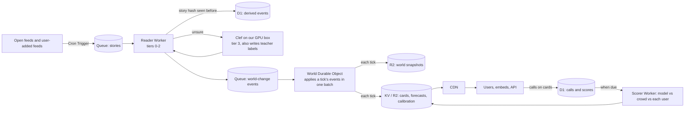
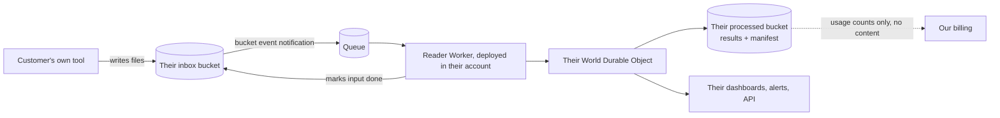
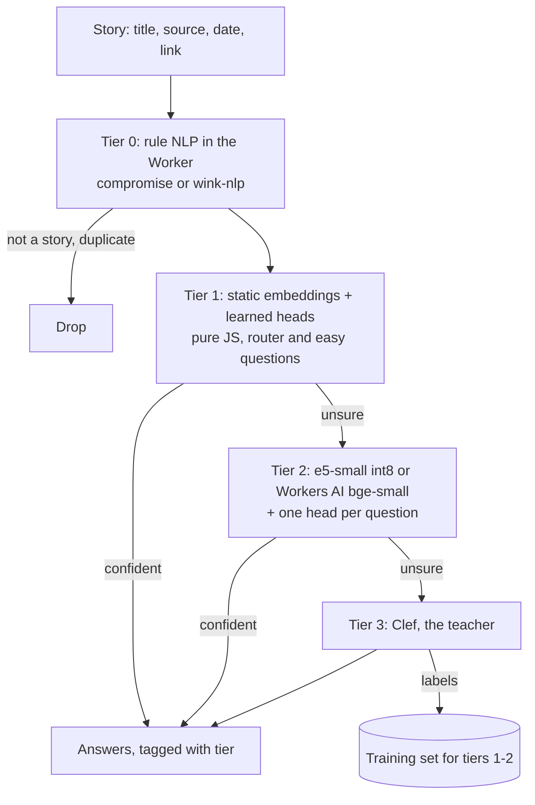
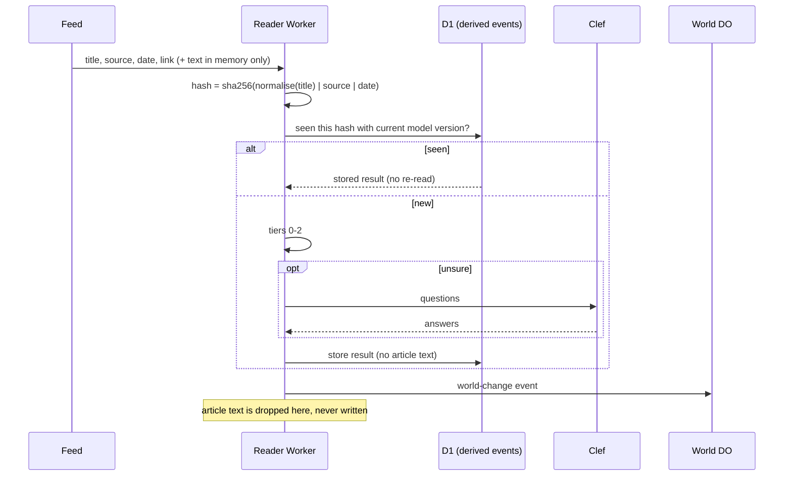
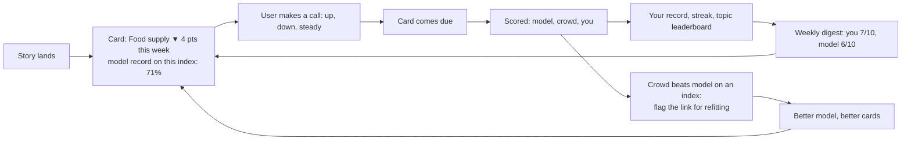

# World engine as a service

Written 2026-10-17. A design proposal, not a plan of record. **Measured** means timed on this machine this week; prices are Cloudflare list prices checked 2026-10-17 (sources at the end); everything else is a projection, marked as such.

## The product in one line

**Free insight, paid engagement.** Anyone can see what today's news is doing to the world and where it is heading, as small forecast cards with an honest track record. The product people pay for is using that output: their own feeds, their own topics, alerts, embeds, the API, and a private version that runs on their own data.

## What the engine does (and why it is cheap)

Every story moves the world in ways a reader never sees. The engine reads a story once, turns it into typed answers (which conditions it moves, which way, fact or forecast or opinion), pushes that change through a rules graph (conditions → how people feel → what they might do → what that draws on), and forecasts where each resource is heading. Every forecast is scored when it comes due.

| Layer | Today (measured) | At scale |
|---|---|---|
| Read: 328 yes/no questions per story | Clef, local: **4.2 s per story** | Small trained reader: **~2 ms per story on CPU, ~17,000 stories/s on one GPU** (speed measured; agreement with Clef not yet tested). Clef teaches it and handles what it is unsure of |
| World change | **2–4 ms per story**, one at a time | Apply each tick's stories in one batch (not measured yet) |
| Cascade to people, decisions, places | **~95–300 ms per update**, not blocking | Aggregate-level model in the cloud; full simulation on our GPU as an optional deep run |
| Forecast and score | Running on the How it works page (in ticks, scored against the engine's own later state) | Real clock, scored against real-world evidence |

Only reading needs a large model, and only to teach. Everything after it is arithmetic.

## Tiers

| Tier | Who | What they get | Price (hypothesis to test) |
|---|---|---|---|
| **Free** | Anyone | Public-source cards: daily outlook per topic, the model's track record, make your own calls and see your score | $0 |
| **Pro** | Individuals, analysts, writers | Own feeds (up to a cap), live updates, alerts, personal calibration history, shareable cards | ~$8/month (Ground News's top consumer plan is $99.99/year) |
| **Team** | Newsrooms, risk, supply chain, comms teams | Shared topic sets, Slack/Teams/webhook alerts, embeddable card widgets, team leaderboards | Per seat or per workspace |
| **API** | Builders | Story → world-change events, index values, forecasts and calibration as JSON | Pay as you go per 1,000 events |
| **Private** | Companies with sensitive data | The whole engine in their own Cloudflare account, fed from their own bucket | Annual licence |

## Architecture

### Public deployment (Cloudflare, public data only)

### Private deployment (customer's own account, bucket handoff)

No integration with the customer's tools: their tool writes to their bucket, ours reads from it. The manifest records input key, hash, time and model versions. The teacher runs on their hardware or not at all; heads are trained from their own labels.

### Classifier tiers (cheapest first)

| Tier | Runs where | Job | Status |
|---|---|---|---|
| 0 Rule NLP (compromise or wink-nlp) | Inside the Worker | Clean, de-duplicate, extract places, people, organisations, dates; route to country and likely topics; drop non-stories | Not built |
| 1 Static embeddings (like BitMob's router, potion-base-8M) + heads | Inside the Worker, pure JS | Router; the easy, repeated questions | Router under 1 ms on our box; not ported |
| 2 e5-small int8 + heads (BitMob's CPU engine) | In the Worker via ONNX Runtime Web (33.8 MB model: under the 64 MiB script limit, tight against 128 MB memory, untested), or Workers AI bge-small with heads retrained | Most of the 328 questions | ~2 ms/story on our CPU; agreement untested |
| 3 Clef Flash Q4 | Our GPU box (public) or theirs (private) | What the gate passes down; teacher labels | 4.2 s/story today |

The gate after tiers 1 and 2 is tuned on held-out data (the Intake method: ≥97% agreement with Clef). **The pass-down share is the main cost lever** (see costs).

## Story lifecycle and reuse

**The hash rule.** `sha256(normalise(title) | source | date)`, where normalise means lowercase, trimmed, collapsed spaces, and date means the day only. Keep a second, title-only hash to link the same wire story across sources. A changed model or question set means a re-read (the version is part of the lookup).

**Reuse the result, never the text.** When another user's feed brings in the same story, they get the stored result instead of a new read. Popular stories are read once, so the cost per user falls as users grow. Results from paywalled articles are reused only for users who requested that same article. Private data is never pooled.

## Where data lives, and where it must not

| Data | Lives in | Kept | Must not |
|---|---|---|---|
| Article text | Worker memory during the read | Seconds | Be written to any store, queue body or log |
| Title, source, date, link | D1 (hot), R2 (archive) | Forever (calibration needs it) | Be shown without a link to the source |
| Story hash + derived result (answers, conditions moved, tier, model version) | D1 hot 30 days, then R2 | Forever | Contain article text |
| World state | Durable Object storage (live); hourly snapshot to R2 | Snapshots 1 year | Be the only copy (snapshots are the backup) |
| Cards (index, forecast, calibration) | KV/R2, cached at the CDN | Latest + 1 year history | — |
| Forecasts and outcomes | D1 | Forever (small; the track record) | Be edited after the fact |
| User account | D1 | While active | Hold more than an email and settings |
| User calls on cards | D1 | Forever, private per user; crowd totals public | Show one user's calls to others without opt-in |
| User feed lists | D1 | While active | Be shared |
| Teacher labels | Private R2 bucket + our box | Per question-set version | Come from private customer data |
| Private inputs and outputs | Customer's own buckets | Their policy | Reach our account (we see usage counts only) |
| Request logs | Workers logs | 7 days | Contain request bodies |

## Costs (monthly, public deployment)

Assumptions: a derived event is ~1 KB; ~3 queue operations a story; ~25 tokens a headline for Workers AI embeddings; ~300 card views a user a month, half served from CDN cache; ~2 ms Worker CPU per story and per uncached view; hot events kept 30 days in D1 (D1's limit is 10 GB per database), the rest archived to R2.

| | Pilot | Growth | Scale |
|---|---|---|---|
| Stories a month (after de-duplication) | 100,000 | 1,000,000 | 10,000,000 |
| Users | 1,000 | 50,000 | 1,000,000 |
| Workers plan | $5 | $5 | $5 |
| Requests (10M included, $0.30/M) | $0 | $0 | ~$45 |
| CPU (30M ms included, $0.02/M ms) | $0 | $0 | ~$6 |
| Workers AI bge-small ($0.020/M tokens) | ~$0.05 | ~$0.50 | ~$5 |
| Queues (1M ops included, $0.40/M) | $0 | ~$0.80 | ~$12 |
| D1 (50M rows written and 5 GB included) | $0 | $0 | ~$4 |
| R2 storage ($0.015/GB-month, egress free) | $0 | ~$0.20 | ~$2 |
| Durable Object (one always-on world, 400,000 GB-s included) | $0 | $0 | $0 |
| **Cloud total** | **~$5** | **~$7** | **~$80** |

**The teacher decides the margin at scale.** Clef reads 4.2 s a story, so one GPU handles about 620,000 stories a month. At 10M stories a month:

| Share passed to Clef | GPU-hours a month | GPUs needed |
|---|---|---|
| 25% | ~2,900 | 4 |
| 5% | ~580 | 1 |
| 1% | ~120 | a fraction of one |

So the reader gate must pass down **5% or less** at scale to run on one GPU. Reuse (read once) and batching Clef requests (not measured) both push this down.

**Margin, illustrated (hypothesis):** at Scale, if 1% of 1M users pay ~$8/month, revenue is ~$80,000 against ~$80 cloud plus one GPU box: well over 90%.

## The engagement product

Free insight draws people in; using the output is what they pay for.

**Card:** one index, its forecast for the chosen horizon, the change so far against the target, days left, the model's track record on that index, and links to the stories that drove it.

**Mechanics:** a call before the card is due; a personal calibration score (moves called right); streaks; topic leaderboards; "beat the model" marks; a weekly digest email; shareable card images served from the CDN. **Points only, never money.** Staking money would make it a regulated prediction market.

**Using the output (the paid part):** alerts when an index you follow moves or a forecast holds for weeks; embeddable card widgets for newsletters and newsrooms; Slack, Teams and webhook delivery; the API; custom views of the resources and decisions a team cares about; the private deployment.

**The crowd is also data.** Where users consistently beat the model on an index, a link in the rules graph is wrong or a resource is missing. That turns engagement into free labels.

## Industry appetite

| Comparable | What it shows | Our difference |
|---|---|---|
| Ground News: news aggregator with free and paid tiers (Pro $9.99/year, Vantage $99.99/year) | Consumers pay for a better view of how news is covered | We show what the news *does* (downstream impact) and forecast it, with a track record |
| Dataminr: real-time alerts from public data; its customers page claims half of the Fortune 50 and the UN, and use in 1,500+ newsrooms | Enterprises pay a lot for early signals from public data | Forecasts with calibration, not only alerts; a private version on the customer's own data |
| Metaculus: free forecasting community, scored by reputation, not money | People engage with forecasting through scoring alone | Every story becomes a forecast automatically; users compete with a model, not only each other |
| Real-money prediction markets | Strong appetite to call outcomes | We stay points-only to avoid financial regulation |

**First segments (proposal):** (1) newsletter writers, analysts and newsrooms, through embeds and the API; (2) supply chain, procurement and risk teams, through resource-strain alerts; (3) comms and marketing teams, through topic and sentiment indices; (4) education and civics, through the call-and-score game. Market sizes are not estimated here; none were checked.

## Sources and rights

- **Show:** a short title, the source name, the date, a link out, and our own output. **Never:** article bodies, long excerpts, images.
- **"We processed it" is fine:** counts and source names ("Read 12,400 stories from 310 sources today").
- **Bring-your-own feeds:** users add feeds and accept terms that they may use them. A directory they choose from is safer than a default bundle pushed to everyone.
- **Consent for reuse:** "Results from articles you process may be reused for other users who request the same article." Only results, never text.
- **Starter public sources, before any user adds one (terms to confirm one by one):** US government works, generally public domain (agency press releases and data such as the Fed, BLS, CDC, NOAA, SEC EDGAR); GDELT (open, dated, event-coded news metadata); Wikinews (Creative Commons); press release wires (made for redistribution; feed terms apply); official statistics (Eurostat, ECB, national offices), mainly as evidence for scoring forecasts. Outlet RSS feeds are "check terms before adding".
- **The EU:** the press publishers' right (copyright directive, Article 15) can require a licence for more than very short extracts. Check EU sources individually.
- **Training data licences:** MentalManip is non-commercial (not usable in a paid service as is); OWASP Benchmark GPL-2.0; dark patterns GPL-3.0; LOGIC undeclared.
- This is the general picture, not legal advice. A media/IP lawyer should review the terms and the caching design before charging money.

## Not just news

The same break-up works for any stream: support tickets (friction → support capacity → churn), sales and service calls (intent → pipeline → buy or walk), filings and earnings calls (demand → cash → hire or cut), reviews (sentiment → brand trust → switch), operations logs (load → compute → scale). What changes is the ontology and the question battery. Internally, a company runs a world model of itself on its own meetings, tickets and CRM notes through the private deployment, so its data never reaches a hosted model provider.

## Honest limits

- **Link strengths are guesses until fitted.** The forecast-and-score loop is how they get fitted.
- **The small reader's accuracy is untested** on the 328 questions; some need world knowledge, where small encoders were weakest (BitMob: ~29% on facts).
- **Ticks are not days.** The demo assumes 1 tick = 1 day; the service needs a real clock and dated stories.
- **Attribution is hard.** Many stories move the same index; calibration needs many forecasts per link.

## Build order (each step has its pass bar set before running)

1. **Reader agreement:** small reader vs Clef on the 328 questions over a few thousand stories. Pass: ≥97% agreement with ≤5% passed to Clef (the bar the cost table needs at scale).
2. **Reader in a Worker:** e5-small int8 under ONNX Runtime Web within 128 MB, or bge-small via Workers AI with retrained heads. Pass: fits, answers meet step 1's bar, cost per million within the table.
3. **Batched world change:** a tick's stories in one step on a copy of the engine. Pass: ≥10,000 stories/s into the world, same end state as one at a time.
4. **Real-clock backtest:** a dated month of news (GDELT); forecasts from week 1 checked against the following weeks. Pass: beats a "nothing changes" forecast on direction.
5. **Free tier pilot:** public sources only, cards and calls, 1,000 users. Pass: users come back to see scored cards (return rate set before launch).
6. **Private pilot:** one customer, bucket handoff in their account. Pass: no content leaves their account (checked from our side's logs and billing data).

## Sources

- Cloudflare: [Workers limits](https://developers.cloudflare.com/workers/platform/limits/), [Workers pricing (incl. Queues, R2, D1, KV)](https://developers.cloudflare.com/workers/platform/pricing/), [Workers AI pricing](https://developers.cloudflare.com/workers-ai/platform/pricing/), [D1 limits](https://developers.cloudflare.com/d1/platform/limits/), [Durable Objects pricing](https://developers.cloudflare.com/durable-objects/platform/pricing/)
- Comparables: [Ground News pricing (third-party summary)](https://www.readless.app/blog/ground-news-pricing-free-vs-paid-2026), [Dataminr customers](https://www.dataminr.com/company/customers), [Metaculus track record analysis (EA Forum)](https://forum.effectivealtruism.org/posts/e9htD7txe8RDdcehm/exploring-metaculus-s-ai-track-record)
