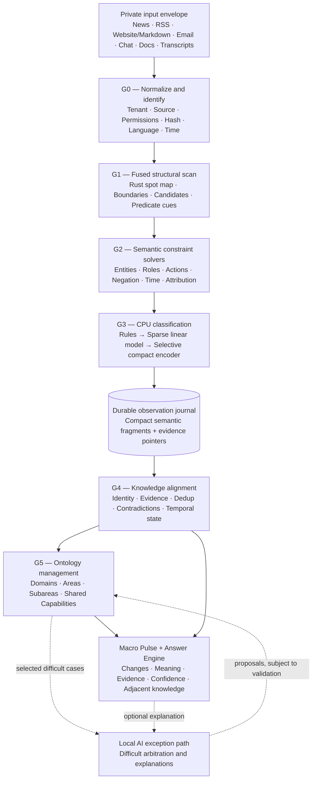
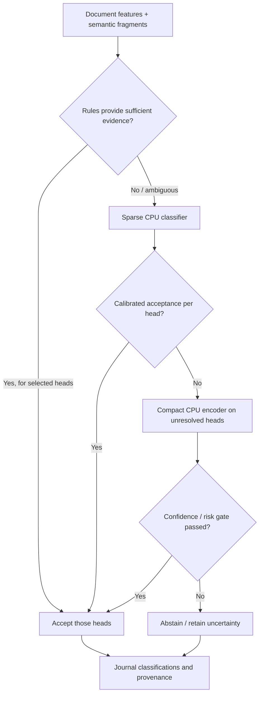
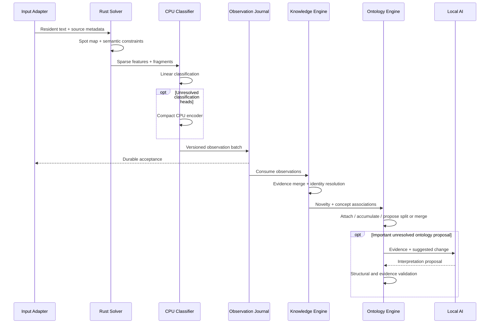
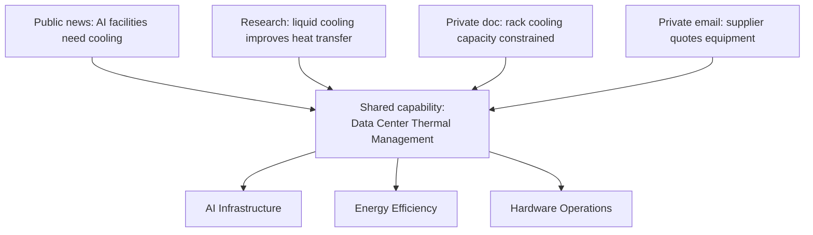
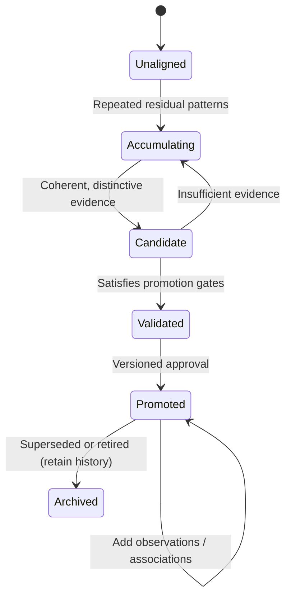
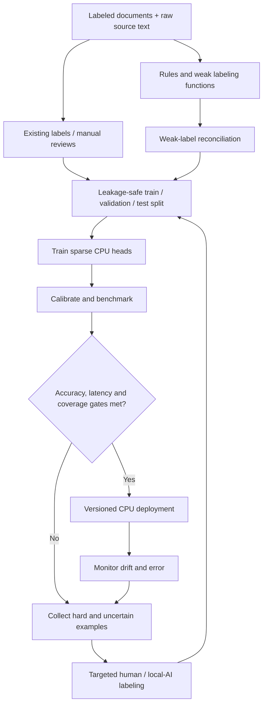

# Knowledge Pipeline v1

**CPU-first · Evidence-driven · Formally verifiable · Private by design**

**Status:** Engineering design and implementation brief. All timing and accuracy thresholds labeled *target* are unvalidated until benchmarked.

## Executive decision

Build a deterministic Rust processing engine that converts text from any authorized online or offline source into compact, classified, source-backed semantic observations. Use inexpensive CPU classifiers for the bulk of categorization, incrementally connect observations to a modest seeded ontology, and reserve local non-frontier AI for select ambiguity, ontology arbitration, and evidence-grounded explanation.

The product has three distinct systems:

1. **Extract:** Rust/CPU real-time structural and semantic processing.
2. **Learn:** CPU graph alignment, evidence reconciliation, and conservative ontology evolution.
3. **Educate:** Indexed retrieval, deterministic answer planning, and selective local AI explanation.

Don't use a full AMR parser in the synchronous path. Borrow its semantic ideas (actors, roles, predicates, negation, modality, attribution) and represent them compactly. Preserve uncertain interpretations rather than asserting unsupported facts.

## 1. Operational architecture



**Synchronous:** G0–G3 and journal append. **Asynchronous:** G4–G5, ontology change proposals, and explanations. No graph database or LLM is required to classify an incoming item.

The source material remains in the owner's authorized envelope. Access policies apply to derived observations and explanations as well as to original documents. Shared public concept definitions must not expose private tenant evidence.

## 2. Stage gates and concrete techniques

| Gate | Default CPU algorithm | Output | When to escalate |
|---|---|---|---|
| G0 — Normalize | Source adapters, hashes, language heuristics, source/permission metadata | Resident text and validated provenance | Unsupported format/language |
| G1 — Scan | SIMD/bit masks, precompiled finite-state machines | Word/span offsets, clause cues, entity candidates | Unsupported structure; preserve raw source |
| G2 — Semantic solver | Bounded predicate-role templates, local weighted constraints | Subject/predicate/object fragments and qualifiers | Ambiguous role assignment |
| G3a — Sparse classify | Hashed character/word n-grams + logistic regression or fastText-like baseline | Multi-label Domains/Areas, content function, conditions | Scores fail calibrated gate |
| G3b — Deeper CPU classify | Optional quantized compact encoder with shared heads | Improved difficult labels | Abstain if still uncertain |
| G4 — Align | Stable IDs, inverted indexes, typed relation matching | Linked observations, evidence sets, conflicts | Identity or contradiction unresolved |
| G5 — Evolve | Provisional residual clusters, novelty and promotion checks | Candidate or approved ontology revisions | Material, unresolved structural decision |
| G6 — Educate | Indexed retrieval, claim/evidence selection, templates; optional local AI | Short answers with sources and adjacent concepts | Complex narrative synthesis |

**Crucial:** Confident classification of an Area must never skip G2 relationship extraction. Document classification and local semantic extraction serve different purposes. G3b should be invoked **per unresolved task/head**, not necessarily for every unresolved document.

## 3. Established methods versus proposed components

| Method | Status | Application |
|---|---|---|
| Hashed n-gram logistic regression / fastText | Established research and engineering approach | Fast CPU multilabel classification |
| Weak supervision (Snorkel-style labeling functions) | Established research approach | Build training labels from rules, with human calibration |
| DenStream-style data-stream clustering | Established research approach | Compare as a method for provisional unaligned concepts |
| ADWIN drift detection | Established research approach | Monitor changes in data/class distributions |
| W3C PROV-O | Published provenance standard | Model source, activity, and derivation |
| Lean 4 | Established proof assistant | Prove model-level invariants and transition rules |
| Bounded predicate-role Rust solver | **Proposed design** | Extract useful subset of AMR-like semantics at low latency |
| Concept promotion scoring/rules | **Proposed design** | Controlled ontology growth; requires calibration |
| 1 ms extraction for 10 MiB | **Stretch target, not measured** | Experiment after scan floor and accuracy have been established |

Useful starting references:

- Joulin et al., *Bag of Tricks for Efficient Text Classification* (fastText): https://arxiv.org/abs/1607.01759
- Ratner et al., *Snorkel: Rapid Training Data Creation with Weak Supervision*: https://arxiv.org/abs/1711.10160
- Cao et al., *Density-Based Clustering over an Evolving Data Stream* (DenStream): https://doi.org/10.1137/1.9781611972757.29
- Bifet and Gavaldà, *Learning from Time-Changing Data with Adaptive Windowing* (ADWIN): https://doi.org/10.1137/1.9781611972771.42
- W3C PROV-O: https://www.w3.org/TR/prov-o/
- Lean 4 documentation: https://lean-lang.org/documentation/

These references support the individual techniques, **not** an assertion that the full proposed architecture is already scientifically validated.

## 4. Classification cascade



**Classifier heads**:

| Head | Output | Semantics |
|---|---|---|
| Domain | Broad sectors | Multilabel |
| Area | Seeded and accepted ontology Areas | Multilabel |
| Content function | Report, opinion, prediction, request, decision, etc. | Potentially multilabel |
| Conditions | Rising, falling, delayed, disrupted, expanded, etc. | Multilabel, with direction |
| Capability | Known capability IDs and candidate associations | Multilabel |
| Novelty | Known / emerging / unsupported | Routing signal, never automatic ontology invention |

For sparse feature vector `x` and label `j`:

\[
z_j = b_j + \sum_{i\in active(x)} w_{ji} x_i
\]

Predicted probabilities need calibration; raw dot products or embedding similarity are **not** calibrated confidence. Select thresholds on a held-out validation set. The operating objective is to minimize expected CPU cost subject to target error and coverage constraints. If the data distribution drifts, re-evaluate those calibrations.

Start with a hashed n-gram linear model, benchmark against an existing compact CPU encoder, and retain the encoder only where it delivers measurable gain. If the already trained shared encoder meets the total latency budget, compare two deployments: encoder-on-every-item versus sparse-first selective escalation. Measure throughput and per-head accuracy.

## 5. Semantic data contract

Every processed source becomes compact observations. Preserve actor/object spans, predicate IDs, uncertainty, factuality, and original evidence offsets. A proposed high-level schema:

```rust
// Interface sketch — not intended as a standalone compiling module.
type TenantId = u64;
type SourceId = u64;
type DocumentId = u64;
type ConceptId = u64;
type EntityId = u64;

#[derive(Clone, Copy)]
struct Span { start: u32, end: u32 }

enum Factuality {
    Asserted, Reported, Planned, Predicted, Denied, Unknown,
}

struct SemanticFragment {
    subject: Option<EntityId>,
    predicate: u32,
    object: Option<EntityId>,
    subject_span: Option<Span>,
    predicate_span: Span,
    object_span: Option<Span>,
    factuality: Factuality,
    polarity: i8,
    evidence_span: Span,
    source_id: SourceId,
}

struct ClassifiedObservation {
    tenant_id: TenantId,
    document_id: DocumentId,
    fragments: Vec<SemanticFragment>,
    domains: Vec<ConceptId>,
    areas: Vec<ConceptId>,
    capabilities: Vec<ConceptId>,
    model_version: u32,
    ontology_version: u32,
}
```

The production hot path should use packed IDs, borrowed slices, preallocated buffers, and explicit capacity bounds rather than heap-allocating the above vectors per token.

A separate provenance record includes source owner, source path/URL, timestamps, hash, permission policy, language, transformation history, and extraction version. Keep identity, factual accuracy, and authorization as separate attributes.

## 6. Rust pipeline sketch

```rust
// Conceptual flow: concrete interfaces/errors still to be implemented.
fn process_document(
    ctx: &mut WorkerContext,
    doc: &DocumentView<'_>,
) -> Result<ObservationBatch, PipelineError> {
    validate_document(doc)?;

    // Resident text; the document-processing benchmark begins here.
    let spots = ctx.spotter.scan(doc.text)?;

    // Local bounded semantic inference over shared scan information.
    let fragments = ctx.semantic_solver.solve(
        doc.text, &spots, &ctx.predicate_rules,
    )?;

    let features = ctx.features.extract(doc.text, &spots, &fragments);
    let mut labels = ctx.linear_model.predict(&features);
    let unresolved = ctx.calibrator.unresolved(&labels);

    if !unresolved.is_empty() {
        let refined = ctx.encoder.predict_selected(doc.text, &unresolved)?;
        labels.merge_selected(refined);
    }

    labels.apply_abstention(&ctx.calibrator);
    let batch = ctx.records.encode(doc, &fragments, &labels)?;
    ctx.journal.append(&batch)?;
    Ok(batch)
}
```

**Execution properties:** Hot-load rule tables, weights and buffers before the clock; reuse spotter features; never require a recognized name from a catalog; keep unknown or contradictory labels; persist before asynchronous graph materialization. Journal append and associated allocations should be separately measured if testing an in-memory extraction-only timing target.

## 7. End-to-end sequence



## 8. Knowledge model: Observation, assertion, concept

Keep these distinct:

1. **Observation:** Source says *Acme announced a factory expansion*. Immutable, provenance-backed, possibly uncertain.
2. **Assertion:** *Acme plans production expansion*. Supported by one or more observations; retains attribution, time and polarity.
3. **Ontology concept:** *Manufacturing capacity expansion*. Reusable, independent of Acme.

An event is not automatically a taxonomy node. A document may be routed to an existing Area without creating a new Area. Cross-document identity matching must distinguish *same name* from *same entity*.



The diagram represents conceptual *association*, not data declassification. Private evidence cannot be retrieved from public-facing answers, even if associated with a shared capability.

### Deterministic alignment

Find candidate assertions through tenant-scoped indexed lookups:

\[
Candidates(f)=I_{entity}(f)\cup I_{predicate}(f)\cup I_{area}(f)
\]

Score candidates using entity compatibility, predicates, semantic roles, time and context. This is a candidate **design**, not a proven accuracy metric:

\[
Match(f,k)=w_eE+w_pP+w_rR+w_tT+w_cC
\]

Evaluate the weights on labeled same-assertion/nonmatch pairs. Attach independent evidence where appropriate; retain incompatible assertions with explicit conflict edges rather than overwriting them.

## 9. Dynamic ontology design

**Seed a small, versioned ontology**: Domains → Areas → optional Subareas → Capabilities. Underlying storage is a typed directed graph, **not** a single-parent tree. A Capability may be reused across Areas without duplication.

**Two independent forms of growth:**

- **Knowledge depth:** More evidence, mechanisms, exceptions, time trends and understanding within existing concepts.
- **Ontology refinement:** A truly useful new specialization, capability, cross-link, split or merge.



Run novelty/discovery predominantly on **residual** observations that do not align satisfactorily with existing concepts. Compare a straightforward bounded micro-cluster baseline with DenStream-style clustering. Avoid reclustering the entire world on every document.

Promotion checks:

- Independent evidence diversity (deduplicate syndication and replay).
- Semantic coherence and recurring relation structure.
- Distinctiveness from current ontology nodes.
- Reusability beyond a short-lived event.
- Explanatory gain: better organizing/retrieving knowledge.
- Valid typed relationships and preserved history.

Automated promotion requires a human-reviewed evaluation regime; otherwise keep the node provisional. A frequently reported unsupported claim may form a *topic*, but it must not be asserted as true.

Typed relations and invariants:

| Relation | Meaning | Rule |
|---|---|---|
| `is_a` | Specializes concept | Acyclic; can infer transitive ancestry |
| `part_of` | Component relationship | Not interchangeable with `is_a` |
| `enables` | Functional link | Requires evidence |
| `requires` | Dependency | Cycles may be valid |
| `related_to` | Adjacent/tangential | Not necessarily transitive |
| `same_as` | Canonical identity | Strong identity evidence needed |
| `supported_by` | Evidence provenance | Authorized valid reference |
| `contradicts` | Conflicting claims | Preserve both claims |

## 10. Macro Pulse and educator

An Area/Capability answer should quickly explain:

- **What it is:** One- or two-sentence common understanding.
- **What is changing:** Dated developments and trends.
- **Why it matters:** The actual supporting relationships and dependencies.
- **What is known:** Supported claims and their provenance.
- **What remains uncertain:** Gaps, contradictions, stale coverage.
- **Adjacent Areas:** Tangential concepts a user might drill into next.

Suggested pulse dimensions (not a single aggregated certainty number):

\[
Pulse(a,t)=(V,\Delta V,N,C,U)
\]

`V` independent observation volume; `ΔV` change against baseline; `N` novelty; `C` conflict; `U` unresolved uncertainty. Also report **coverage** and **freshness** independently from evidence confidence.

Generate answers by selecting authorized evidence and claims first, then optionally use local AI to narrate them. Never let the LLM introduce unsupported statements. A useful objective is to maximize relevance and support while penalizing redundancy and unsupported claims, constrained by evidence visibility. This objective is a design hypothesis, not a Lean theorem about factual truth.

## 11. Lean 4 verification boundaries

Lean should verify the behavior of the **reference kernel** and ontology update rules, not run inside the per-document hot path. Formal proof of a Lean model does **not** automatically prove arbitrary optimized Rust code: compare the reference model against Rust via differential, property-based and generated tests; a fully verified implementation correspondence would require additional work.

### Evidence set algebra

```lean
abbrev Evidence := Nat → Prop

def merge (a b : Evidence) : Evidence :=
  fun id => a id ∨ b id

theorem merge_preserves_left
    (a b : Evidence) (id : Nat)
    (h : a id) : merge a b id := by
  exact Or.inl h

theorem merge_comm
    (a b : Evidence) :
    merge a b = merge b a := by
  funext id
  apply propext
  exact Or.comm (a id) (b id)

theorem merge_idempotent
    (a : Evidence) :
    merge a a = a := by
  funext id
  apply propext
  constructor
  · intro h
    cases h with
    | inl ha => exact ha
    | inr ha => exact ha
  · intro h
    exact Or.inl h
```

Evidence membership as union has the useful **associative, commutative, idempotent** shape. Actual evidence IDs must distinguish independent corroboration from replay/syndication; that assignment is not proved by union alone.

### Source span validity

```lean
structure ValidSpan (documentLength : Nat) where
  start : Nat
  stop : Nat
  ordered : start ≤ stop
  withinDocument : stop ≤ documentLength

theorem valid_span_start_bound
    {n : Nat} (s : ValidSpan n) :
    s.start ≤ n := by
  exact Nat.le_trans s.ordered s.withinDocument
```

### Proof roadmap

| Phase | Prove | Verify empirically |
|---|---|---|
| P0 | Bounds/valid references | Correct source/text offset mapping |
| P1 | Evidence merge associativity, commutativity, idempotence | Replay vs syndicated source identity |
| P2 | Stream chunk invariance under stated state/finalization semantics | Different chunk sizes and latency |
| P3 | Role/type constraints and preserved qualifiers | Extraction precision and recall |
| P4 | `is_a` acyclicity and well-typed graph changes | Semantic suitability of associations |
| P5 | Evidence retention and lineage across splits/merges | Quality of concept evolution |
| P6 | Optimized solver and reference model produce equivalent normalized output | Performance, memory, compiler/runtime behavior |

**Streaming property to target:** processing `x ++ y` as one input gives the same canonical fragments as processing `x`, carrying forward bounded state, then `y`, and finalizing. The state bound must account for long spans and the supported language grammar.

## 12. Reproducible test corpus

| Test | Example | Expected behavior |
|---|---|---|
| T01 | New battery technology improves grid storage | Energy and Technology classification |
| T02 | Veltrix acquired Calden Robotics | Unseen candidate entities and acquisition edge |
| T03 | Analysts expect electricity prices to rise | Prediction, not confirmed rise |
| T04 | Company denies plans to close factory | Denial/negation maintained |
| T05 | Liquid cooling reduces server heat | Thermal management capability |
| T06 | Hospitals deploy AI diagnostic hardware | Cross-domain links |
| T07 | Same story syndicated by 20 sources | Distinct citations but not 20 independent observations |
| T08 | Repeated references to unknown technology | Provisional concept rather than instant promotion |
| T09 | Private document aligns with public story | No private evidence leakage |
| T10 | Same bytes in 1 KiB, 64 KiB, whole-file chunks | Identical canonical output |

Also include hard negatives: incomplete sentences, quotation boundaries, weak context, non-English input, unknown predicates, misleading capitalization, dense entity text, entity coreference, multiword expressions, contradictory reports. Synthetic tests verify functional plumbing; use a held-out human-reviewed corpus for true accuracy and unseen-entity generalization.

## 13. CPU classifier training and rollout



Use independent group splits by source/event/time where appropriate, so syndicated copies of the same story do not appear in both train and test. Maintain human-reviewed ground truth. Weak labels and LLM labels are training inputs, not independent validation truth. Benchmark linear-first escalation against encoder-every-item using equal hardware and workloads.

## 14. Release gates and performance plan

| Metric | Acceptance criterion / target |
|---|---|
| Provenance | 100% of accepted observations have valid source pointers |
| Tenant access | No unauthorized disclosure in exhaustive policy test scenarios |
| Stream invariance | Identical normalized output for supported chunk schedules |
| Replay safety | No duplicate evidence membership on replay |
| Structural correctness | Committed ontology changes satisfy typed graph invariants |
| Classification | Per-head precision, recall, coverage, calibration and abstention |
| Open-world semantic extraction | Strict entity-span F1 and relation F1, including unseen names |
| AI utilization | Escalations / 1,000 items, reason, token and compute cost |
| Latency | p50/p95/p99 per stage; news items and dense 10 MiB inputs |
| Ontology | Promotion precision, duplicate concepts, unsupported merges |

| Workload | Initial performance objective |
|---|---|
| Resident 10 MiB byte scan | Investigate 1 ms stretch floor |
| Resident 10 MiB fused semantic solver | Compare against existing sub-20 ms NER |
| Sparse classifier per short news item | Sub-millisecond *inference-only* target; measure |
| Compact CPU encoder per short news item | Existing sub-50 ms end-to-end classification goal |
| Graph alignment | Async bounded candidate search |
| Ontology changes | Batch and version; never block intake |

The in-memory 10 MiB/1 ms goal corresponds to ~10.5 GB/s effective traversal. It is an aggressive **stretch**, particularly for actual relation inference on one core. Separate scan cost, candidate cost, semantic solver cost, output cost, journal cost, and total steady-state system throughput. No hot-load/cold-start time should enter the extraction benchmark, but production latency should also measure those operational components independently.

## 15. Suggested repository structure

```text
knowledge-engine/
├── crates/
│   ├── intake/              # Adapters and normalization
│   ├── provenance/          # Source IDs and permissions
│   ├── spotter/             # Existing fast Rust scan
│   ├── semantic-solver/     # Predicate/role constraints
│   ├── sparse-features/     # Hashed feature extraction
│   ├── cpu-classifier/      # Linear + optional encoder
│   ├── observations/        # Immutable semantic records
│   ├── knowledge-align/     # Canonical identity and evidence
│   ├── ontology-core/       # Areas, capabilities, relations
│   ├── ontology-discovery/  # Residual clustering and promotion
│   ├── macro-pulse/         # Aggregations, novelty, drift
│   └── answer-engine/       # Evidence retrieval/explanations
├── proofs/
│   ├── Evidence.lean
│   ├── Spans.lean
│   ├── Streaming.lean
│   ├── Relations.lean
│   └── Ontology.lean
├── tests/
│   ├── golden/
│   ├── unseen-entities/
│   ├── ambiguity/
│   ├── tenant-isolation/
│   └── streaming/
└── benches/
    ├── scan-floor/
    ├── semantic-solver/
    ├── classification/
    └── end-to-end/
```

## 16. Implementation checklist

- [ ] **1. Benchmark baseline:** Profile spotter/NER, 10 MiB scan floor, linear classifier and existing CPU encoder. Record core, candidate density, instruction and cache metrics, latency.
- [ ] **2. Canonical observation contract:** Define valid spans, source IDs, provenance, qualifiers, evidence deduplication and model/ontology versions.
- [ ] **3. Sparse CPU classifier:** Train hashed n-gram models for Domain, Area, content function and conditions. Calibrate independently; compare encoder baseline.
- [ ] **4. Fused predicate-role solver:** Reuse spot map; implement bounded rules, exact source offsets, negation/modality/attribution.
- [ ] **5. Deterministic knowledge alignment:** Tenant-scoped indexes, assertion matching, conflicting evidence, stable IDs, async journal consumer.
- [ ] **6. Dynamic ontology:** Residual clustering, validated promotion, splitting/merging, lineage and versioning.
- [ ] **7. Macro Pulse and educator:** Evidence-backed answers, pulse metrics, missing knowledge, adjacent capability suggestions; local AI only as needed.

## 17. Decisions and explicit assumptions

1. **Text-first** processing. Voice/video must first be transcribed; images are out of scope for the core knowledge pipeline.
2. **Private envelopes.** Every derived observation remains scoped to authorized principals; public conceptual vocabulary is allowed, not unauthorized content sharing.
3. **Existing Rust primitives.** Prefer reusing the current fused spot map and deterministic NER work rather than creating a new tokenizer/parser.
4. **No full AMR on intake.** Use minimal AMR-inspired roles/predicates/context, not complete semantic graph parsing.
5. **CPU first.** Small trainable classifiers are allowed. Local non-frontier AI is an exceptional, budgeted component.
6. **Small seeded ontology.** Domains, Areas, optional subareas, Capabilities and shared relations; progressively refine rather than learning everything from zero.
7. **Separation of concerns.** Extraction accuracy, evidence truthfulness, graph structural invariants, and user-facing explanation quality are independently evaluated.
8. **Proofs are bounded.** Lean proves model correctness under its stated assumptions, not classifier generalization or hardware execution time.
9. **Durability boundary.** Journal first; graph alignment and ontology evolution consume asynchronously, with replay-safe processing.
10. **Macro Pulse.** Prioritize answers, confidence dimensions, novelty and adjacent concepts over a wiki dump.

### Final recommendation

The first two implementation experiments should run **in parallel**: (a) sparse CPU classifier versus the existing shared encoder on identical data, and (b) a bounded predicate-role solver fused with the existing Rust spot map. Meanwhile, formally specify the semantic observation contract and evidence merge semantics in Lean 4. Those results decide where computational complexity and verification effort will deliver genuine value.
