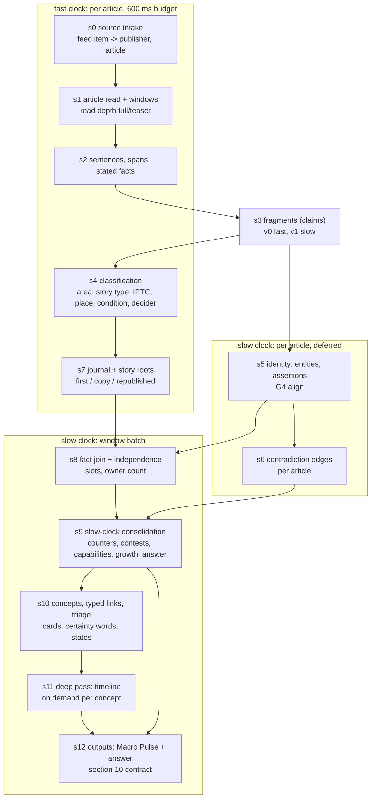
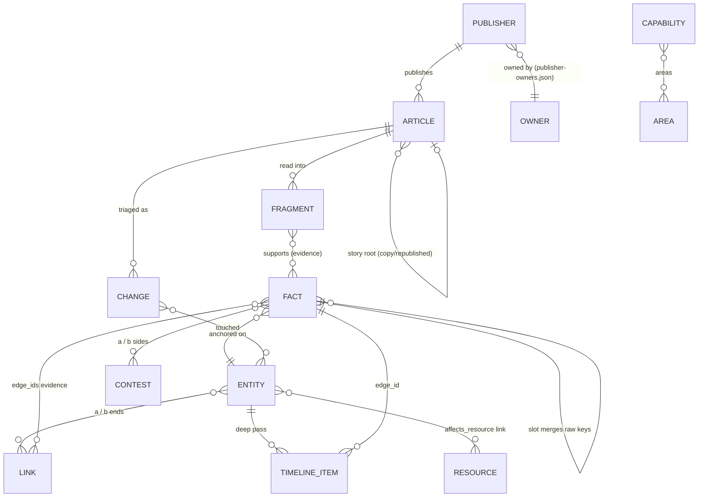

# Process flow: knowledge pipeline, stage by stage

Scope: what exists in `/workspace/knowledge_pipeline` code and data on 2026-11-23. Read-only description. Status words: **built** (runs end to end, output exists), **partial** (runs, but part of the stage is deferred, not attached or weak), **missing** (no code produces it). Everything downstream of the fast chain is marked PROVISIONAL by the code itself. Numbers: staged areas **c1** (Fiona the hippo, 34 articles, 16 publishers) and **mix** (Gulf strikes + energy, 40 articles, 13 publishers), from `sample-c1.json` / `sample-mix.json` `meta.timing` (bench :18770, 2026-11-23) unless another source is named.

## Clocks (the code has three, the playbook names two)

| Clock | What runs | Trigger | Code |
|---|---|---|---|
| fast | per-article chain G0-G3 + journal append, 600 ms budget | an article arrives | `live_trace.py` (`Chain.trace`), `journal.py` |
| slow, per article | parts too heavy for the budget: claims v1, direction, change proposal, function/factuality heads, G4 identity, contradictions | after the article, over a finished window | `slow_clock.py` (writes `slow.jsonl`) |
| slow, batch | fact join, independence, slots, counters, contests, capabilities, concepts, links, triage, answer | once per window (playbook: checkpoints, e.g. every 10k articles) | `consolidate.py`, `slow_consolidate.py`, `concepts_v0.py` |

Playbook section 18 item 3 says "two clocks". In code the second clock is split in two (per-article deferred, and window batch). The bundle labels each stage with the real one.

## Flowchart of stages

S3 spans two clocks: the v0 claim record is made in the fast chain, claims v1 (dependency rules) is deferred (`claims_v1: deferred` in the article stage list) and runs in `slow_clock.py`.

## Entity relationship diagram

RESOURCE is an `entity` with `kind = "resource"`; CAPABILITY is an `entity` with `kind = "capability"` (see entity-model.md). OWNER is a field of PUBLISHER, not a separate array.

## Stages

Order follows the data. Timing is the p50 per article (fast) or per article (slow clock), measured by `export-bundle.py` from `/api/raw/sample?id=` records (c1 / mix). "In" and "out" are the entity types in `entity-model.md`.

| # | Stage | Purpose (one line) | In | Out | Module / function | Clock | Timing (c1 / mix) | Status |
|---|---|---|---|---|---|---|---|---|
| s0 | Source intake | Take a feed item from the news queue with its publisher label | feed item | publisher, article | `newsreader/` queue (`queue.sqlite`), `live_trace.select_sql` (columns id, url, source, title, teaser, body, published, ready_at) | fast | not in the chain stage list | built |
| s1 | Article read + windows | Record read depth (full text or teaser, and why) and cut the text into windows | article | article.read_depth, read_reason, words | `live_trace.Chain.trace` stage `windows`; `live_trace.read_info` | fast | windows 48 / 39 ms | built. Teaser-only on 13 of 34 (c1) and 17 of 40 (mix) articles |
| s2 | Sentences, spans, stated facts | Find sentence bounds, dates, amounts, names with character offsets | article | sentence (factuality, negated, modal), span, stated fact | `scan_gate.scan`; stages `scan_dates`, `facts` (`facts_lib`), `span_rules`, `independent_counter`, `tags_bundles` | fast | facts 29 / 22 ms; scan_dates 1 ms | built |
| s3 | Fragments (claims) | Read subject, predicate, object (with spans) from sentences | sentence | fragment | fast: `raw_core.claims_v0`, `fewnerd_typing` (stage `ner_fewnerd`); slow: `claims_units.extract_claims` -> `claims_v1.extract` (spaCy lg dependency rules, attribution, negation, modality) | fast + slow per article | ner 15 / 13 ms; claims v1 37 / 27 ms (slow) | partial. Two claim lists exist and are not aligned (see entity-model.md, Fragment) |
| s4 | Classification | Label the article: area, story type, IPTC node, place, condition; decider verdicts | article, sentence | article labels, decider outcomes | stages `area_function`, `domain_rollup`, `topic_landing`, `condition`, `place_student`, `capability_list`, `decider` (`decider.py`) | fast | topic_landing 160 / 151 ms; whole chain p50 420 / 303 ms, p90 805 / 635 ms | partial. `function_sentence`, `novelty`, `time`, `factuality_story` are `not_attached` in the chain (`heads_unattached`); function and factuality run on the slow clock (`raw_core.attach_heads`) |
| s7 | Journal + story roots | Mark each article first / copy / republished and append to the durable journal | article | story kind, story root | `journal.story_keys`, `journal.classify`, `journal.Durable`; stage `journal_durable` | fast | 0 ms | built. Story roots are duplicate clusters, not threads (ladder-review 1.6) |
| s5 | Identity: entities, assertions | Give each mention an entity id, aliases, IPTC placement; build assertions and G4 edges | fragment | entity (G4 identity), assertion, G4 edge | `g4_align.align`, `g4_align.Store`; `raw_core.merge_units`, `raw_core.identity` | slow per article | identity_g4 377 / 560 ms; build_rec 131 / 115 ms | partial. G4 store entities match the concept ids on 35 of 38 (c1) and 42 of 65 (mix) concepts (`meta.coverage.entities.g4`) |
| s6 | Contradiction edges | Find earlier assertions that a new one contradicts (polarity, rise/fall, claim vs denial) | assertion | contradiction edge | `g4_align.contradict_edges`, `report_contradictions` | slow per article | 0.4 / 0.7 ms | partial. Result is empty for c1 (state `empty`); 6 pairs in mix after consolidation |
| s8 | Fact join + independence | Merge near-identical facts into one slot; count independent owners, collapsing syndicated copies | assertion, fragment evidence | fact, independent owner count | `consolidate.syndication_groups`, `consolidate.independence` (uses `publisher-owners.json`), `consolidate.anchors`, `consolidate.slot_merge` with `fact_join.Scorer` (e5-small-v2, threshold 0.530) | slow batch | inside consolidation: 26.4 s (c1), 48.5 s (mix) for the whole pass (`slow_consolidate_run.json` `seconds`) | built, PROVISIONAL. Merge rate 8.6% (c1), 7.2% (mix) of raw facts |
| s9 | Slow-clock consolidation | Count new / reinforced / contested / bridging; list contested pairs, capabilities, growth, yield; draft answer statements | fact | fact flags, contest, capability, growth rows, yield, answer | `consolidate.consolidate`, `slow_consolidate.knowledge`, `slow_consolidate.contested_pairs`, `consolidate.capability_layer`, `educate.auto_answer` | slow batch | in the same pass as s8 | built, PROVISIONAL. `counters.new` equals all facts (562 of 562, 753 of 753): it does not separate old from new inside one window |
| s10 | Concepts, links, triage | Build one card per concept, typed links between concepts, certainty word and state, and one triage verdict per article | fact, contest, G4 entity | entity (concept card), link, change | `concepts_v0.build`, `concepts_v0.make_canon`, `link_rel`, `find_processes` | slow batch | not timed separately (reads the files s9 wrote) | partial, PROVISIONAL v0. Most links are co-occurrence (32 of 44 in c1, 40 of 75 in mix are `affects_resource`) |
| s11 | Deep pass + timeline | For one concept: dated fact lines, sub-concepts, open questions, history from other windows | entity | timeline item | `concepts_v0` deep pass; `GET /api/raw/deep?src=area:<k>&concept=<id>` (120 s time box) | slow on demand | p50 97 / 113 ms, max 139 / 120 ms, none cut | partial. Timeline is real and dated; sub-concepts, accounts and history are noisy (ladder-review 1.4, 1.7) |
| s12 | Outputs: Macro Pulse, answer | Deliver the playbook section 10 answer: what it is, what is changing, why, known, uncertain, adjacent | all of the above | answer statement, pulse inputs | `knowledge.answer` (statements with edge refs), `counters`, `growth`, `yield` in `knowledge.json` | slow batch | n/a | **missing** as a contract: no function computes `Pulse(a,t) = (V, dV, N, C, U)`, coverage or freshness; only its raw inputs exist (counters, growth, yield). The answer text is one auto question ("auto: fiona") |

## What each clock leaves behind (where the data lives)

| Stage group | Written to (per window) | Exposed by bench endpoint |
|---|---|---|
| fast chain | `<trace>/chain.jsonl`, `<trace>/a/<seq>.json` | `/api/raw/sample?src=area:<k>&id=<article id>&n=1` |
| slow per article | `<trace>/slow.jsonl`, `<trace>/g4/store.jsonl` | same `sample` record, keys `slow`, `g4` |
| slow batch | `<trace>/slow_consolidate/{consolidated,knowledge,evolved,...}.json` | `/api/raw/knowledge`, `/api/raw/concepts`, `/api/raw/deep` |

Window root: `/workspace/demo/mockups/structure-live/area-<k>/trace/`. Areas come from `/api/raw/areas`.

## Stage-level gaps worth knowing (each from a command or a code read)

1. Claims v1 and G4 identity are per-article work that the chain defers; until `slow_clock.py` has run on a window, `identity_g4`, `claims_v1`, `contradictions` read `deferred` and the knowledge layer has nothing to join.
2. Fast-chain budget: playbook and `slow_clock.py` cite 600 ms; measured p90 is 805 ms on c1 (`meta.timing.fast_chain_ms_per_article`), so the budget is exceeded on the slow tail on this host.
3. Playbook G5 (ontology evolution, `evolve.py`, `evolved.json`) exists as a file in the window; it is not exported to the bundle (concept promotion lives in `meta.funnel.concepts` only). Marked missing in the bundle.
4. Source intake (s0) metadata beyond feed name, url, published: no tenant, permission, language or hash field is exported (playbook G0 lists them). Missing in the data the bench serves.
